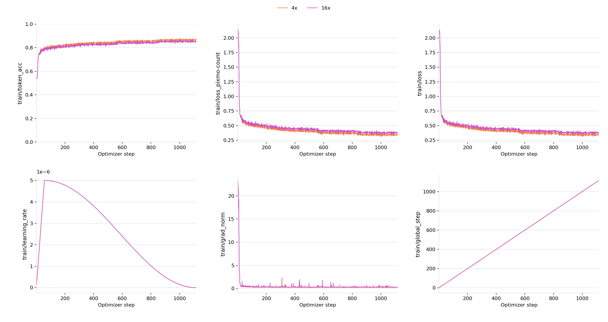
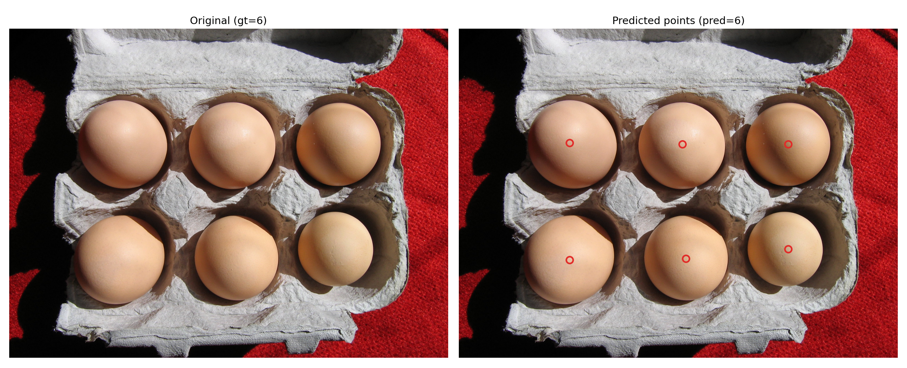

# MiniCPM-V 4.7 1B Fine-Tuning Tutorial (ms-swift)

## Model and Task Overview

This section uses the counting task [allenai/pixmo-count](https://huggingface.co/datasets/allenai/pixmo-count) as a fine-tuning example.

Training task:

- Input an image and a counting question
- The target `assistant` response first lists the coordinates of each target object in `x y` format, for example, `<point>573 489</point>`, and then outputs the final count, such as `0`, `3`, or `10`.

## Environment Setup

**Minimum runnable installation steps**

```bash
conda create -n "MiniCPM-V-4.7-1B-Counting" python=3.10 -y
conda activate "MiniCPM-V-4.7-1B-Counting"

pip install torch==2.8.0 torchvision==0.23.0

pip install \
  transformers==5.18.0 accelerate==1.13.0 \
  deepspeed==0.18.3 peft==0.18.1 trl==0.29.1 datasets==4.8.4 \
  flash-linear-attention==0.5.2 ninja

MAX_JOBS=32 NVCC_THREADS=4 pip install --no-build-isolation flash-attn==2.8.3
git clone https://github.com/modelscope/ms-swift.git
cd ms-swift
git fetch origin pull/10338/head
git checkout FETCH_HEAD
pip install -e .
pip install transformers==5.18.0
```

Note: MiniCPM-V 4.7 is officially supported by `transformers>=5.18.0`. Please make sure the final version of `transformers` in your environment is larger or equal to `5.18.0`.

**Reference dependency versions**

```text
python                        3.10.0
accelerate                    1.13.0
deepspeed                     0.18.3
flash_attn                    2.8.3
flash-linear-attention        0.5.2
ms_swift                      4.6.0.dev0 (PR #10338)
torch                         2.8.0+cu128
torchvision                   0.23.0
transformers                  5.18.0
```

### 2.2 Data Preparation

Download the dataset from [allenai/pixmo-count](https://huggingface.co/datasets/allenai/pixmo-count) and convert it into the ms-swift format.

**Data format reference:**
  ```json
  {
      "messages": [
          {
              "content": "<image>\nCarefully observe the image. Are there any people in the image? If yes, please list their respective coordinates and provide the total count. If no, answer 0.",
              "role": "user"
          },
          {
              "content": "<think>\n\n</think>\n\nThe respective coordinates of people: <point>236 469</point>, <point>307 232</point>, <point>362 434</point>, <point>485 521</point>, <point>487 340</point>, <point>615 386</point>, <point>735 441</point>, <point>870 615</point>. So the total count is 8.",
              "role": "assistant"
          }
      ],
      "images": [
          "/path/to/images/*.jpg"
      ],
      "source_file": "pixmo-count",
      "orig_index": 1,
      "channel": "pixmo-count"
  }
  ```
- For the Counting task, adding supervision on point prediction can improve fine-tuning performance. Therefore, we recommend concatenating the `points` coordinates from the dataset into the assistant response.
- Since MiniCPM-V 4.7 normalizes image coordinates to `0~1000`, the point coordinates also need to be transformed as follows:
  ```python
  def expected_norm(x_px: float, y_px: float, width: int, height: int) -> Tuple[int, int]:
      return int((x_px / width) * 1000.0), int((y_px / height) * 1000.0)
  ```

## Launch Training

After configuring the model path, training set path, validation set path, and output directory, run the following script to start training.

```bash
# run_swift.sh
#!/bin/bash
set -euo pipefail

export CUDA_VISIBLE_DEVICES="${CUDA_VISIBLE_DEVICES:-0,1,2,3,4,5,6,7}"
export NPROC_PER_NODE="${NPROC_PER_NODE:-8}"
export MASTER_PORT="${MASTER_PORT:-29632}"

export WANDB_API_KEY="${WANDB_API_KEY:-}"
export WANDB_PROJECT="${WANDB_PROJECT:-MiniCPMV47-Counting}"
export WANDB_RUN_NAME="${WANDB_RUN_NAME:-minicpmv47_1b_count}"
export WANDB_NAME="${WANDB_NAME:-minicpmv47_1b_count}"

export DOWNSAMPLE_MODE="${DOWNSAMPLE_MODE:-4x}"

GRADIENT_CHECKPOINTING=true
MODE_ARGS=()
if [[ "${DOWNSAMPLE_MODE}" == "16x" ]]; then
    GRADIENT_CHECKPOINTING=false
    MODE_ARGS+=(--ddp_find_unused_parameters true --check_model false)
fi

SWIFT_BIN="${SWIFT_BIN:-swift}"
MODEL_PATH="${MODEL_PATH:-/path/to/MiniCPM-V-4.7-1B}"

TRAIN_DATA="${TRAIN_DATA:-/path/to/task_dataset/train/pixmo_count_train_with_channel}"
VALID_DATA="${VALID_DATA:-/path/to/task_dataset/val/validation-00000-of-00001-swift.parquet}"

DEEPSPEED_CONFIG="${DEEPSPEED_CONFIG:-zero2}"
OUTPUT_DIR="${OUTPUT_DIR:-/path/to/outdir}"

${SWIFT_BIN} sft \
  --model "${MODEL_PATH}" \
  --model_type minicpmv4_7 \
  --template minicpmv4_7 \
  --add_non_thinking_prefix true \
  --run_name "${WANDB_RUN_NAME}" \
  --dataset "${TRAIN_DATA}" \
  --val_dataset "${VALID_DATA}" \
  --deepspeed "${DEEPSPEED_CONFIG}" \
  --tuner_type full \
  --torch_dtype bfloat16 \
  --freeze_llm False \
  --freeze_vit False \
  --freeze_aligner True \
  --packing false \
  --padding_free false \
  --max_length 4096 \
  --num_train_epochs 4 \
  --per_device_train_batch_size 1 \
  --per_device_eval_batch_size 1 \
  --gradient_accumulation_steps 16 \
  --gradient_checkpointing "${GRADIENT_CHECKPOINTING}" \
  --vit_gradient_checkpointing true \
  "${MODE_ARGS[@]}" \
  --learning_rate 5e-6 \
  --warmup_ratio 0.05 \
  --logging_steps 1 \
  --save_steps 132 \
  --eval_strategy steps \
  --eval_steps 80 \
  --save_total_limit 30 \
  --load_from_cache_file false \
  --dataset_num_proc 16 \
  --dataloader_num_workers 16 \
  --enable_channel_loss True \
  --attn_impl flash_attn \
  --loss_scale ignore_empty_think \
  --output_dir "${OUTPUT_DIR}" \
  --report_to none
```

Key parameter notes

- Training supports two visual token compression ratios, `16x` and `4x`, which are controlled by `export DOWNSAMPLE_MODE="${DOWNSAMPLE_MODE:-4x}"`.
- Keep `--packing false` and `--padding_free false` for the current 4.7 template.
- `--add_non_thinking_prefix true` can append `<think>\n\n</think>\n\n` to training prompts, achieve no-thinking training.

## Training Curves



## Evaluation Results

Evaluation metrics explanation:

| Metric | Description |
| --- | --- |
| Acc@0 | Exact match accuracy (predicted value = ground truth) |
| Acc@0 Top1 | The highest Acc@0 score among all checkpoints saved during training |
| Acc@0 Avg.Top3 | The average Acc@0 score of the top three checkpoints saved during training |

The table below shows the results under two visual token compression ratios:

| Model | Visual Token Compression Ratio | Acc@0 Top1 | Acc@0 Avg.Top3 |
| --- | --- | --- | --- |
| MiniCPM-V 4.7 1B | 16 | 55.2 | N/A [1] |
| MiniCPM-V 4.7 1B | 4 | 57.7 | N/A [1] |
| Fine-tuned model | 16 | 79.3 | 79.1 |
| Fine-tuned model | 4 | 82.5 | 82.5 |

  <small>[1]: MiniCPM-V 4.7 1B is the original model without fine-tuning, so only one Acc@0 result (Acc@0 Top1) is available and Acc@0 Avg.Top3 cannot be computed.</small>

Output example:

  ```text
  Q: Carefully observe the image. Are there any eggs in the image? If yes, please list their respective coordinates and provide the total count. If no, answer 0.

  A: The respective coordinates of eggs: <point>252 347</point>, <point>252 703</point>, <point>509 351</point>, <point>517 699</point>, <point>750 351</point>, <point>750 670</point>. So the total count is 6.
  ```

  
