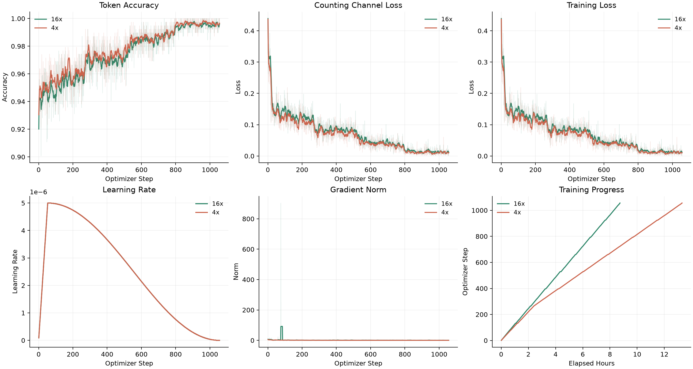
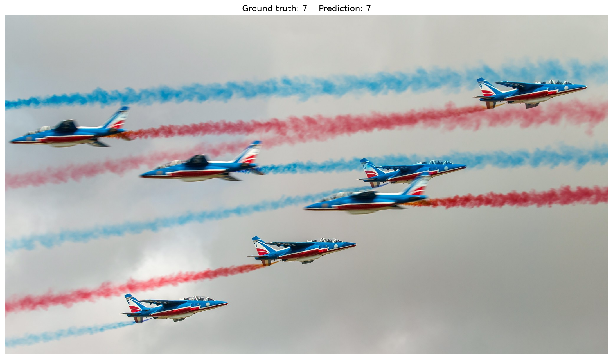

# MiniCPM-V 4.7 35B-A3B 微调教程 (ms-swift)

## 模型与任务概览

本章节以 counting 任务 [allenai/pixmo-count](https://huggingface.co/datasets/allenai/pixmo-count) 作为微调示例。

训练任务：

- 输入一张图片和一个计数问题
- `assistant` 目标输出以单个整数表示最终数量，例如 `0`、`3`、`10`。

## 环境说明

**最小可运行安装步骤**

```bash
conda create -n "MiniCPM-V-4.7-35B-A3B-Counting" python=3.12 -y
conda activate "MiniCPM-V-4.7-35B-A3B-Counting"

pip install torch==2.10.0 torchvision==0.25.0

pip install \
  transformers==5.18.0 accelerate==1.15.0 \
  deepspeed==0.18.3 peft==0.18.1 trl==0.24.0 \
  flash-linear-attention==0.5.2 wandb ninja einops safetensors tokenizers sentencepiece

MAX_JOBS=32 NVCC_THREADS=4 pip install --no-build-isolation --no-binary causal-conv1d causal-conv1d==1.7.0
git clone https://github.com/modelscope/ms-swift.git
cd ms-swift
git fetch origin pull/10338/head
git checkout FETCH_HEAD
pip install -e .
pip install transformers==5.18.0
```

注意：MiniCPM-V 4.7 35B-A3B 在 `transformers>=5.18.0` 版本被官方支持。请保证最后安装的 `transformers` 版本为 `5.18.0` 及以上。

**依赖版本参考**

```text
python                        3.12.3
accelerate                    1.15.0
deepspeed                     0.18.3
flash-linear-attention        0.5.2
ms_swift                      4.6.0.dev0 (PR #10338)
torch                         2.10.0+cu128
torchvision                   0.25.0
transformers                  5.18.0
```

## 数据准备

从 [allenai/pixmo-count](https://huggingface.co/datasets/allenai/pixmo-count) 下载数据集，并将其转换为 ms-swift 格式。

**数据格式参考：**
  ```json
  {
      "messages": [
          {
              "content": "<image>\nCarefully observe the image. How many people are there in the image? Answer with a single integer only.",
              "role": "user"
          },
          {
              "content": "8",
              "role": "assistant"
          }
      ],
      "images": [
          "/path/to/images/*.jpg"
      ],
      "source_file": "pixmo-count-train",
      "orig_index": 1,
      "channel": "pixmo-count-no-points"
  }
  ```

## 启动训练

配置好模型路径、训练集路径、验证集路径和输出目录后，执行以下脚本即可以开始训练。

```bash
# run_swift.sh
#!/bin/bash
set -euo pipefail

export CUDA_VISIBLE_DEVICES="${CUDA_VISIBLE_DEVICES:-0,1,2,3,4,5,6,7}"
export NPROC_PER_NODE="${NPROC_PER_NODE:-8}"
export MASTER_PORT="${MASTER_PORT:-29632}"
export PYTORCH_ALLOC_CONF="${PYTORCH_ALLOC_CONF:-expandable_segments:True}"

export WANDB_API_KEY="${WANDB_API_KEY:-}"
export WANDB_PROJECT="${WANDB_PROJECT:-MiniCPMV47-35B-A3B-Counting}"
export WANDB_RUN_NAME="${WANDB_RUN_NAME:-mcpmv47_35b_count}"
export WANDB_NAME="${WANDB_NAME:-mcpmv47_35b_count}"

export DOWNSAMPLE_MODE="${DOWNSAMPLE_MODE:-4x}"

SWIFT_BIN="${SWIFT_BIN:-swift}"
MODEL_PATH="${MODEL_PATH:-/path/to/MiniCPM-V-4.7-35B-A3B}"

TRAIN_DATA="${TRAIN_DATA:-/path/to/task_dataset/train.jsonl}"
VALID_DATA="${VALID_DATA:-/path/to/task_dataset/validation.jsonl}"

DEEPSPEED_CONFIG="${DEEPSPEED_CONFIG:-zero3}"
if [[ "${DEEPSPEED_CONFIG}" == zero3 ]]; then
    DEEPSPEED_CONFIG="$(python - <<'PY'
import json
from importlib.resources import files

config = json.loads(files('swift').joinpath('config/zero3.json').read_text())
config['zero_optimization']['sub_group_size'] = 100000000
print(json.dumps(config))
PY
)"
fi
SCRIPT_DIR="$(cd "$(dirname "${BASH_SOURCE[0]}")" && pwd)"
OUTPUT_DIR="${OUTPUT_DIR:-path/to/outdir}"

${SWIFT_BIN} sft \
  --model "${MODEL_PATH}" \
  --model_type minicpmv4_7 \
  --template minicpmv4_7 \
  --add_non_thinking_prefix true \
  --run_name "${WANDB_RUN_NAME}" \
  --dataset "${TRAIN_DATA}" \
  --val_dataset "${VALID_DATA}" \
  --deepspeed "${DEEPSPEED_CONFIG}" \
  --experts_impl grouped_mm \
  --tuner_type full \
  --torch_dtype bfloat16 \
  --freeze_vit False \
  --freeze_aligner False \
  --packing false \
  --padding_side left \
  --gradient_checkpointing true \
  --max_length 4096 \
  --num_train_epochs 4 \
  --per_device_train_batch_size "${PER_DEVICE_TRAIN_BATCH_SIZE:-1}" \
  --gradient_accumulation_steps "${GRADIENT_ACCUMULATION_STEPS:-16}" \
  --learning_rate 5e-6 \
  --warmup_ratio 0.05 \
  --logging_steps 1 \
  --save_steps 132 \
  --eval_strategy steps \
  --eval_steps 80 \
  --save_total_limit 30 \
  --load_from_cache_file false \
  --dataset_num_proc 8 \
  --dataloader_num_workers 4 \
  --enable_channel_loss True \
  --attn_impl sdpa \
  --loss_scale ignore_empty_think \
  --output_dir "${OUTPUT_DIR}" \
  --report_to wandb
```

关键参数说明

- 训练支持 `16x`、`4x` 两种视觉 Token 压缩率，通过 `export DOWNSAMPLE_MODE="${DOWNSAMPLE_MODE:-4x}"` 参数进行控制。
- 对于这个基于 Qwen3.5 的模型，请使用 `--packing false`，与已验证的训练配置保持一致。
- `--add_non_thinking_prefix true` 可以在训练提示词后加入 `<think>\n\n</think>\n\n`，实现无 thinking 训练。

## 训练过程



## 评测结果

评测指标说明：

| 指标 | 说明 |
| --- | --- |
| Acc@0 | 精确匹配率，即预测值与真实值完全一致 |
| Acc@0 Top1 | 验证集 Acc@0 最高的 checkpoint 在测试集上的 Acc@0 分数 |
| Acc@0 Avg.Top3 | 按验证集 Acc@0 排名前三的 checkpoint 在测试集上的 Acc@0 平均分数 |

下表展示了两种视觉 Token 压缩率设置下的评测结果：

| 模型 | 视觉 Token 压缩率 | Acc@0 Top1 | Acc@0 Avg.Top3 |
| --- | --- | --- | --- |
| MiniCPM-V 4.7 35B-A3B | 16 | 69.1 | N/A [1] |
| MiniCPM-V 4.7 35B-A3B | 4 | 73.2 | N/A [1] |
| Fine-tuned model | 16 | 81.4 | 81.3 |
| Fine-tuned model | 4 | 85.0 | 84.3 |

  <small>[1]: MiniCPM-V 4.7 35B-A3B 为原始模型，未经微调，仅有一个 Acc@0 结果 (Acc@0 Top1)，无法计算 Acc@0 Avg.Top3。</small>

输出样例：

  ```text
  Q: Carefully observe the image. How many airplanes are there in the image? Answer with a single integer only.

  A: 7
  ```

  
