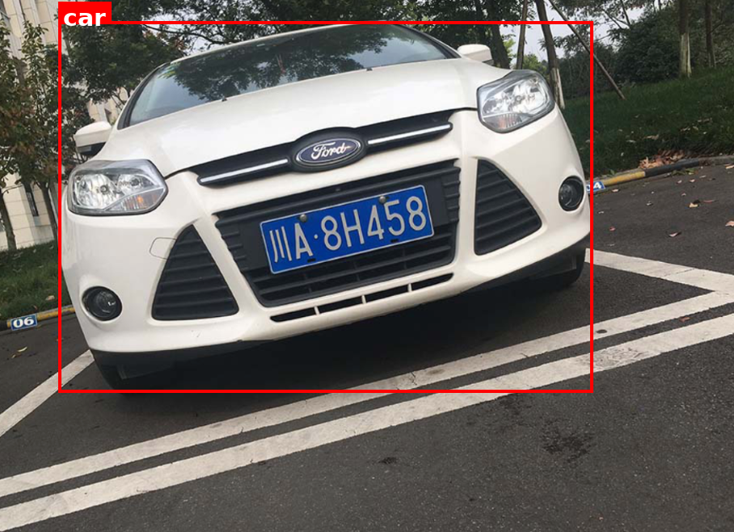

# 视觉定位（MiniCPM-V 4.7）

> MiniCPM-V 4.7 返回的定位区域为 `\boxed{[x1, y1, x2, y2]}`，坐标按 0–1000 归一化。
> 更早的构建使用 `<box>x1 y1 x2 y2</box>`；下面的解析同时兼容两种格式。

## 示例代码

```python
import re
import torch
from PIL import Image, ImageDraw, ImageFont
from transformers import AutoProcessor, AutoModelForImageTextToText


def load_font(size: int):
    # 用真实 TTF 保证标签清晰；找不到时回退到 PIL 内置字体
    for path in (
        "/usr/share/fonts/truetype/dejavu/DejaVuSans-Bold.ttf",
        "/System/Library/Fonts/Supplemental/Arial Bold.ttf",
    ):
        try:
            return ImageFont.truetype(path, size)
        except OSError:
            continue
    return ImageFont.load_default(size=size)


def extract_bbox(response: str):
    # v4.7：`\boxed{[x1, y1, x2, y2]}`；旧格式：`<box>x1 y1 x2 y2</box>`
    for pat in (r"\\boxed\{\s*\[?\s*([\d,\s]+?)\s*\]?\s*\}", r"<box>\s*([\d\s]+?)\s*</box>"):
        m = re.search(pat, response)
        if m:
            box = [int(v) for v in re.split(r"[,\s]+", m.group(1).strip()) if v]
            if len(box) == 4:
                return box
    raise ValueError(f"Can't find bbox in response: {response!r}")


def draw_bbox(image: Image.Image, bbox, label: str | None = None, color: str = "red"):
    w, h = image.size
    x1, y1, x2, y2 = (
        int(bbox[0] / 1000 * w),
        int(bbox[1] / 1000 * h),
        int(bbox[2] / 1000 * w),
        int(bbox[3] / 1000 * h),
    )
    draw = ImageDraw.Draw(image)
    draw.rectangle([x1, y1, x2, y2], outline=color, width=max(3, round(min(w, h) / 150)))
    if label:
        font = load_font(max(18, round(min(w, h) / 22)))   # 字号随图片缩放
        tb = draw.textbbox((0, 0), label, font=font)
        tw, th = tb[2] - tb[0], tb[3] - tb[1]
        ty = max(0, y1 - th - 8)
        draw.rectangle([x1, ty, x1 + tw + 12, ty + th + 8], fill=color)  # 文字底色
        draw.text((x1 + 6, ty + 2), label, fill="white", font=font)
    return image


model_path = "openbmb/MiniCPM-V-4.7-1B"  # 或 "openbmb/MiniCPM-V-4.7-35B-A3B"
img_path = "./assets/car.png"
question = (
    "Please provide the bounding box coordinate of the region this sentence "
    "describes: <ref>car</ref>"
)

processor = AutoProcessor.from_pretrained(model_path)
model = AutoModelForImageTextToText.from_pretrained(
    model_path, dtype="auto", device_map="auto", attn_implementation="sdpa",
).eval()

image = Image.open(img_path).convert("RGB")
messages = [{
    "role": "user",
    "content": [
        {"type": "image", "image": image},
        {"type": "text", "text": question},
    ],
}]
inputs = processor.apply_chat_template(
    messages, add_generation_prompt=True, tokenize=True,
    return_dict=True, return_tensors="pt",
    chat_template_kwargs={"enable_thinking": False},
).to(model.device)

with torch.inference_mode():
    out_ids = model.generate(**inputs, max_new_tokens=512)

response = processor.decode(
    out_ids[0][inputs["input_ids"].shape[-1]:], skip_special_tokens=True
)
print("Model output:", response)

bbox = extract_bbox(response)
draw_bbox(image, bbox, label="car").save("./assets/car_grounding.png")
```

## 效果展示

原图：


定位后：



## 推荐采样参数

在 instruct 模式下生成时，推荐使用：`temperature=0.7`、`top_p=0.95`、`top_k=100`、`min_p=0.0`、`presence_penalty=0`、`repetition_penalty=1.03`。
